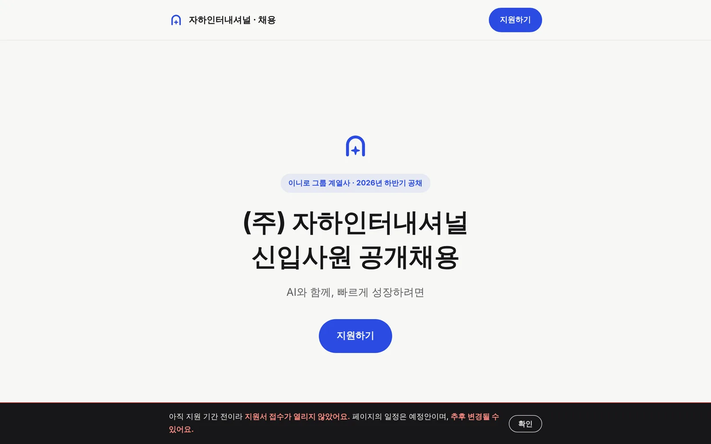
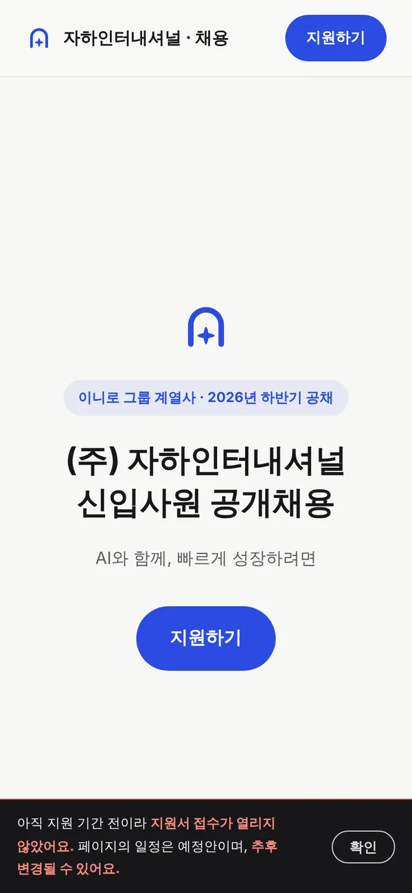

<div align="center">


# (주)자하인터내셔널 신입사원 채용공고

**AI와 함께, 빠르게 성장하려면** — 졸업 프로젝트 하나로 취업하시게요?


[**채용공고 보기 →**](https://jiwonsudo.github.io/zaha-intl-recruit/)




</div>

## 소개

(주)자하인터내셔널의 신입사원 공개채용을 안내하는 단일 페이지 랜딩입니다. 프레임워크 없이 HTML·CSS·JavaScript만으로 만들었고, 데스크톱과 모바일(노치 영역 포함) 모두에 맞춰 반응형으로 구성했습니다. 링크 공유 시 보이는 OG 이미지와 메타 태그도 설정되어 있습니다.

## 구조

```
index.html              페이지 본문 · 메타 태그
style.css               스타일 · 반응형 레이아웃
script.js               인터랙션
zaha_intl_logo.webp     로고
zaha_recruit_og.webp    공유용 OG 이미지
```

## 로컬에서 보기

```bash
python3 -m http.server 8000
# http://localhost:8000
```

`main` 브랜치가 GitHub Pages로 바로 배포됩니다.
